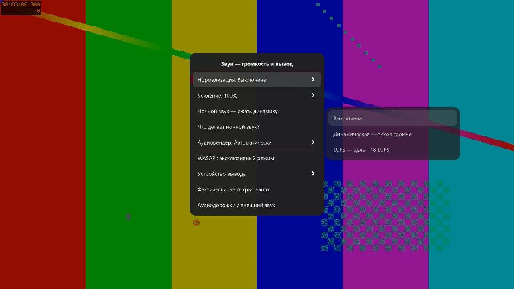
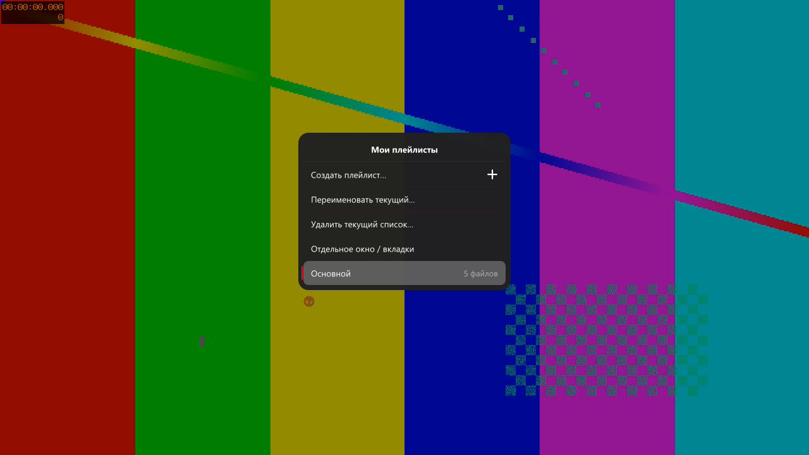
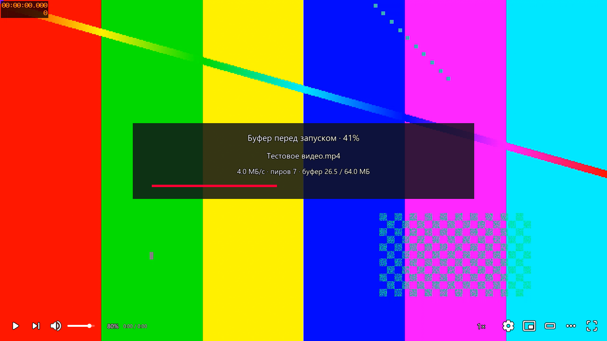

# Подробности и предыдущая документация

Актуальная стартовая страница: [README.md](README.md). Ниже сохранены технические подробности и исторический протокол; при расхождении по текущему выпуску ориентируйтесь на README и Releases.

# mpv Neon v12

Windows x64 плеер на базе mpv и изменённого uosc. Темы Glass, Deck, Neon и YouTube; YouTube используется по умолчанию. Сохранённый выбор темы пользователя не заменяется. Запуск: mpv-neon.exe или Start.cmd. mpv.exe — движок; yt-dlp.exe — служебный загрузчик.

v12 подготовлена на основе GitHub v11.4, коммит `c448d2078fcaa781ada9541a2701e1c736ef5e2a`.
[Релиз v12: установщик и Portable ZIP](https://github.com/jeronimo701/mpv-neon/releases/tag/v12).

## Новое в v12

- F5 → «Звук»: динамическая / LUFS-нормализация, усиление 100–400% с лимитером, независимый ночной режим, WASAPI/OpenAL и выбор устройства. Ctrl+Shift+A открывает звук напрямую.
- F2 → Anime4K: все официальные A, B, C, A+A, B+B, C+A в вариантах Fast и HQ. Прежний облегчённый профиль оставлен. HQ требует проверки производительности на реальном видео.
- TorrServer: индикатор подготовки с процентом серверного стартового буфера, скоростью и пирами. Это не процент скачивания всего торрента; без размера буфера показывается ожидание, а не выдуманный процент.
- Именованные плейлисты с автосохранением очереди, позиции и выбранного файла. Ctrl+Shift+P — библиотека; Ctrl+P — отдельное окно с вкладками и цветами текущей темы. При запуске без файла список восстанавливается на паузе. Другой файл при новом запуске создаёт отдельный список, не стирая старый.
- Подробнее: [изменения и ограничения v12](mpv-portable/docs/V12.md).

## Скриншоты v12

Собственный захват окна mpv на синтетическом видео, без рабочего стола и других
приложений. Индикатор TorrServer показан на локальном тестовом HTTP-макете,
а не на настоящей загрузке торрента.

F12 — темы, F2 — изображение/шейдеры, F3 — TorrServer, F4 — качество сетевого видео, F5 — настройки. A/Ф — аудиодорожки, включая внешние файлы рядом с видео и в непосредственных подпапках. Русская раскладка поддерживается для горячих клавиш. SponsorBlock доступен в меню ПКМ: категории, пропуск, ускорение, метки; настройки сохраняются локально.

Изменения после v6: тема YouTube, доработки меню/громкости, внешние аудиодорожки, SponsorBlock, русские сочетания клавиш, три режима установки, сохранение настроек при обновлении, встроенный стартовый логотип и остановка только своего TorrServer при замене файлов.

**Lossless.dll в публичную сборку не входит.** Без собственной совместимой лицензированной DLL LSFG недоступен; обычное воспроизведение и интерфейс работают без неё. Проект не загружает эту библиотеку. Фактическая частота LSFG и совместимость GPU требуют отдельной проверки.

Личные настройки, история, закладки, кэши и базы TorrServer исключены из дистрибутива. Сервер по умолчанию — анонимный loopback. Установка и обновление описаны в docs/INSTALLER.md.

Источники и лицензии: docs/SOURCES.json, docs/licenses/, runtime/python/LICENSE.txt и THIRD-PARTY.md. Это компоновка сторонних компонентов, не форк ядра mpv. Лицензия Jeronimo701 относится только к отдельным материалам, перечисленным в LICENSE-SCOPE.md; она не перелицензирует mpv/uosc и другие компоненты.

Репозиторий: https://github.com/jeronimo701/mpv-neon . Установщик не имеет доверенной подписи издателя. Проверяйте SHA-256 релиза. Ограничения проверок: PUBLIC-VALIDATION.md в репозитории.

## Установка и обновление

Скачайте `mpv-Neon-Setup-v12-public.exe` либо готовый `mpv-neon-v12-portable.zip`
из [релиза v12](https://github.com/jeronimo701/mpv-neon/releases/tag/v12).
Мастер предлагает Portable, установку для текущего пользователя и для всех
пользователей (с UAC). При обновлении выберите прежний режим и папку;
сначала сохраните независимую копию настроек. Portable ZIP распакуйте в отдельную
папку и запустите `mpv-neon.exe`. В архиве имена двух русских TXT записаны в OEM CP866;
если распаковщик искажает их, используйте распаковщик с поддержкой этой кодировки
либо возьмите установщик в режиме Portable. Подробности: [инструкция](public/INSTALLER.md).

## Лицензии

[LICENSE.txt](LICENSE.txt) действует только на отдельные авторские материалы из [LICENSE-SCOPE.md](LICENSE-SCOPE.md). Папка mpv-portable полностью исключена. mpv, uosc, их модификации, TorrServer и другие зависимости сохраняют свои лицензии; лицензия личного использования не вводит для них запрет продажи или использования организациями. Прежний тег v6 и установщик не изменяются.

## Исходники и сборка

В mpv-portable находятся конфиги, Lua/C исходники, ресурсы интерфейса и лицензии; исполняемые зависимости находятся в установщике и не входят в Git. Версии и источники: [SOURCES.json](mpv-portable/docs/SOURCES.json), [THIRD-PARTY.md](THIRD-PARTY.md).

[Сборка установщика](installer-source/README.md) компилирует текущие C# launcher и
окно плейлиста из исходников. `prepare-public.ps1` очищает полную папку уже
обновлённого плеера v12; скрипт не обновляет код v11.4 до v12 сам по себе.
Git checkout не является готовой запускаемой сборкой, бинарные зависимости
нужно получить отдельно по SOURCES.json.

Проверки именно публичного выпуска: [PUBLIC-VALIDATION.md](PUBLIC-VALIDATION.md). Полный аппаратный тест GPU, UAC и все внешние сайты отдельно не подтверждены.
